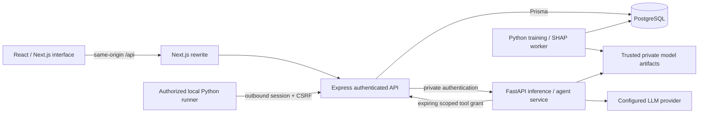

# CoreWise AI — project and technology overview

The authorized Neon/pgvector follow-up adds guarded pooled/direct environment selection, verified backup/restore tooling, a local PostgreSQL 17.7-compatible pgvector image, pinned MiniLM embeddings and owner-scoped semantic retrieval. See [Neon and pgvector guide](NEON-PGVECTOR.md) and STATUS for actual local versus remote verification.

The assistant now supports Groq through the existing single LangChain client, 19 owner-scoped evidence tools and safe Markdown rendering. See [Groq configuration, architecture and demonstration](GROQ-INTEGRATION.md) and STATUS for actual verification; mocked tests do not establish live connectivity.

This guide describes the implemented repository, including M0–M7, the functional restoration and the homepage authentication hydration repair. Dependency versions below are the project's pinned versions, not claims about the latest upstream releases.

## Purpose

**CoreWise AI — Intelligent CPU–GPU Workload Prediction and Optimization Using Machine Learning and Agentic AI.**

The application helps a user decide whether a configured workload should execute on their CPU or GPU, inspect the assumptions behind an estimate, compare it with an explicitly authorized local measurement, and retain explainable evidence. Its workflow is:

**Detect/import hardware → configure workload and capabilities → estimate/predict CPU and GPU times → recommend a processor → explicitly run a bounded benchmark → compare prediction with measurement → inspect SHAP and export a report.**

Analytical equations, supervised regression, measured benchmarks and an optional LLM assistant have separate roles. The assistant is not the numerical prediction engine.

## Main technologies

| Layer | Technology used | Purpose |
| --- | --- | --- |
| Web framework | Next.js 16.4.6, App Router, Turbopack | Server rendering, routes, development compilation and API forwarding |
| UI | React 19.1.10, TypeScript 5.9.3 | Typed interactive components and application state |
| Styling | Tailwind CSS 4.3.5, CSS design tokens | CoreWise visuals, responsive layouts and reduced-motion support |
| Themes | next-themes 0.4.6 | Dark, light and system theme preference |
| Client API state | TanStack Query 5.107.1 | Requests, owner-keyed caches, invalidation and server/client query hydration |
| Forms/contracts | React Hook Form 7.92.0, Zod 4.6.7, Zod resolvers | Validated forms and shared API input/output contracts |
| UI building blocks | Radix Slot, CVA, clsx, tailwind-merge | Reusable button/component composition |
| Charts/icons/fonts | Recharts 3.10.1, Lucide React, Fontsource Inter/Manrope | Evidence charts, hardware/navigation icons and local fonts |
| API runtime | Node.js, Express 5.3.0, strict TypeScript | Personal API, ownership, analytical calculations and orchestration |
| Persistence | PostgreSQL 17.7, Prisma 6.19.3 | Users, sessions, configurations, evidence, jobs and model metadata |
| Authentication | Argon2 0.45.2, express-session 1.19.0 | Password hashing and signed-cookie, database-backed sessions |
| API protection | csrf-sync, express-rate-limit, Helmet | Session-bound CSRF, request limits and response security headers |
| Logging/exports | Pino, pino-http, PDFKit | Redacted structured logs and PDF report generation |
| Private Python API | Python 3.13, FastAPI 0.162.7, Uvicorn, Pydantic | Dataset validation, fitted inference, SHAP and agent orchestration |
| Data/scientific processing | NumPy 2.5.4, pandas 3.1.1, SciPy | Dataframes, arrays, preparation and numerical operations |
| Regression | scikit-learn 1.9.1, XGBoost 3.4.1 | Linear Regression, Random Forest and XGBoost comparison |
| Explainability/artifacts | SHAP 0.54.1, Joblib 1.6.0 | Actual fitted-model explanations and private model serialization |
| Agentic AI | LangGraph 1.2.22, LangChain Core/OpenAI integration | Bounded routing, authenticated tools and configured LLM responses |
| Database/HTTP clients | psycopg, HTTPX | Private worker persistence and outbound service/runner calls |
| CPU runner | NumPy, psutil 7.2.2, threadpoolctl | Allowlisted CPU kernels, detection, sampling and thread limits |
| Optional NVIDIA GPU runner | CuPy CUDA 13 package 14.2.0, CUDA libraries, nvidia-smi | Actual GPU kernels, transfer timing and supported vendor readings |
| Native credential storage | keyring 25.7.0 | Runner credential storage in a supported OS vault |
| Tooling | pnpm workspaces, ESLint, Prettier, Ruff | Pinned workspace dependencies, type/style checks and Python linting |
| Tests | Vitest, Supertest, pytest, Playwright, Axe | API/database, Python, browser and accessibility regression |
| Local infrastructure | Docker Compose | Persistent, loopback-bound PostgreSQL |
| Deployment reference | Caddy reverse-proxy example | Documented HTTPS front door; public deployment is not performed |

The UI uses reusable local components with shadcn-style composition; this is not a separate hosted UI service. The OpenAI-compatible provider integration is optional and must be configured. It does not imply that an external model is currently connected.

## Architecture and service boundaries



The browser never connects directly to PostgreSQL or the private Python service. Express enforces identity, ownership and operation bounds. Training/SHAP work is claimed by the durable Python worker from database jobs. The native runner is a separate explicitly invoked program; opening a browser page cannot read hardware sensors or execute a benchmark.

## Features

### Accounts and sessions

- Registration, login, logout, current-user lookup and protected personal routes.
- Profile/display-name editing and independent hardware selection/default preferences.
- Argon2id password hashes, HttpOnly/SameSite cookies, PostgreSQL sessions, absolute expiry and logout invalidation.
- CSRF on writes, including login/registration; authentication rate limiting.
- No credentials in browser localStorage/sessionStorage.
- Server-side session resolution and query hydration keep homepage SSR and the first client render consistent.

### Hardware library

- Owned profile creation, listing, detail view, editing and confirmed deletion.
- Search/filter, default profile and selected profile.
- General manufacturer/model/OS/description; CPU identity/cores/frequencies; GPU identity/VRAM/bandwidth/optional compute capability; installed RAM/type/frequency.
- Import from an owned paired runner's actual detection snapshot, preserving unknown values.
- RAM uses GiB; vendor GPU bytes are explicitly converted to decimal GB in profile capacity fields.
- Manual edits become USER_ENTERED and remove the native telemetry binding.

### Monitoring and local agent

- One-time pairing and a runner-only credential stored in the OS vault.
- CPU/GPU/RAM detection, supported psutil utilization/memory readings and NVIDIA vendor readings.
- Bounded monitoring command, latest-sample ingestion and fresh/stale/expired states.
- Stale/expired readings are withheld. Unsupported CPU temperature/GPU/fan fields are not fabricated.
- No browser hardware detection, continuous monitoring daemon, fan control, clock, voltage or power tuning.

### Workload analyzer and analytical estimates

- Saved workload CRUD, duplication and editable illustrative presets.
- Explicit workload size/unit, operations, arithmetic intensity, parallel fraction, memory/transfer footprint and repetitions.
- Explicit performance capabilities rather than inferring FLOPS from GHz.
- Tested backend Amdahl/roofline calculations, CPU/GPU timing components, transfer/launch costs, tolerance and memory-capacity warnings.
- Immutable saved comparisons with ANALYTICAL provenance, model version, units, assumptions and limitations.

### Measured benchmarks

- Five fixed families: vector addition, matrix multiplication, stable sorting, sum reduction and image blending.
- Multiple bounded sizes and FP32/FP64 where supported.
- CPU samples and GPU compute, host-to-device transfer, device-to-host transfer and end-to-end samples.
- Correctness checks, raw samples, environment metadata, bounded deadlines/memory and a single-process safety lock.
- Owned queue/history, cancellation and CSV/measured dataset export.
- Queueing in the UI does not execute hardware. Native execution needs explicit authorization and `--execute`.

### Machine learning

- Validated CSV ingestion and separately labeled synthetic demonstration datasets.
- Separate CPU/GPU Linear Regression, Random Forest and XGBoost models.
- Reproducible preprocessing, grouped train/validation/test splits and no repeated-configuration leakage.
- Validation-based model selection; MAE, RMSE, R² and workload-family errors.
- Durable jobs/logs, model registry, explicit activation and trusted artifact version/hash verification.
- Saved model-backed predictions with immutable configuration/model references.
- Only MEASURED or explicitly SYNTHETIC_DEMO labels train supervised models; analytical estimates are not relabeled as measurements.

### Recommendations and comparison

- Processor selection ranks exact compatible measured evidence, measured-trained prediction and analytical estimation.
- Exact compatibility checks prevent comparing unrelated hardware, units, precision, kernels, transfer conventions or timing scopes.
- Signed prediction-versus-measurement errors when compatible evidence exists.
- Analytical workload-size crossover brackets and transfer/launch analysis.
- Observed CPU-thread comparisons where evidence exists; no unsupported thread-optimization claim.
- Missing model/capability reasons and an analytical fallback where valid inputs exist.
- Resident-data batch-size optimization is outside the current contract and is not fabricated.

### Explainability

- Local CPU/GPU SHAP waterfalls and global importance from actual fitted artifacts.
- Exact saved model versions, training-only backgrounds, held-out evaluation references and additive checks.
- SHAP values use **ln(ms)**, not causal millisecond effects. They explain the model's output rather than prove a hardware cause.

### AI assistant

- LangGraph routing/tool/response workflow with a configured provider.
- Owner-scoped retrieval and bounded read-only analytical/prediction previews through Express.
- Streamed conversations, persisted messages and source/evidence references.
- Session/CSRF-bound expiring turn grants, budgets and timeouts.
- No arbitrary shell, SQL, filesystem, network or write tools. Retrieved text is untrusted data.
- An unconfigured provider produces an unavailable state. Test-provider mocks are not evidence of external LLM connectivity.

### Reports, dashboard and settings

- Reports combine owned configurations, analytical comparisons, predictions, measured runs and completed SHAP.
- Immutable snapshots and exact PDF/CSV bytes with hashes; preview, history, download, printing and confirmed deletion.
- Reporting does not silently trigger training, hardware execution or LLM requests.
- Dashboard onboarding/journey, selected hardware, source-aware monitoring, saved evidence, model readiness and benchmark history.
- Responsive navigation, dark/light/system themes, keyboard interactions and reduced-motion support.

## Screens

| Route | Purpose |
| --- | --- |
| `/` | Public overview or authenticated compute journey |
| `/register`, `/login`, `/profile` | Account access and profile |
| `/hardware-library` | Owned hardware management |
| `/system-monitor` | Bounded native telemetry/readiness |
| `/workload-analyzer` | Workload configurations and assumptions |
| `/cpu-vs-gpu` | Saved analytical/ML comparisons |
| `/benchmark-lab` | Pairing, queue, measurements and exports |
| `/ml-predictions` | Datasets, fitting, evaluation, registry and inference |
| `/explainability` | SHAP explanations |
| `/ai-assistant` | Configured agent conversations and evidence |
| `/reports` | Immutable evidence reports |
| `/settings` | Appearance, account/hardware defaults and service readiness |

## Data provenance

| Label | Meaning |
| --- | --- |
| USER_ENTERED | A supplied specification or assumption |
| MEASURED | Runner-observed data or explicitly attested measured labels, with their actual source |
| ANALYTICAL | A documented equation-based calculation |
| PREDICTED | An actual fitted model's output |
| SYNTHETIC_DEMO | Explicitly illustrative/generated demonstration data |

These labels are not interchangeable. Runner observations and uploaded measured labels are not independently certified specifications. An estimate is not a measurement; an active model does not establish strong accuracy.

## Repository and runtime

```text
frontend/           Next.js routes, UI, themes and API consumers
backend/src/        Express authentication, personal APIs and analytical model
backend/tests/      API/TypeScript tests
backend/prisma/     PostgreSQL schema and additive migrations
backend/ml/         Private Python service, fitting/SHAP worker and artifacts
backend/local-agent/ Authorized native runner and bounded monitoring
packages/types/     Shared Zod/TypeScript contracts
packages/config/    Shared compiler configuration
tests/              Browser tests and fixtures
scripts/            Workspace/verification utilities
obsidian/           Documentation and preserved research vault
deploy/             Production reference configuration
.artifacts/         Ignored local verification/evidence outputs
```

Development defaults: Next.js `127.0.0.1:3000`, Express `127.0.0.1:4000`, private Python service `127.0.0.1:8000`, PostgreSQL host port `55432`. Run workspace commands from the repository root. The private Python health/API boundary is authenticated; an unauthenticated response is not an instruction to expose it publicly.

See README for environment/dependency setup, then use `pnpm dev`. Main checks are `pnpm typecheck`, `pnpm lint`, `pnpm test`, `pnpm build`, `pnpm test:e2e` and `pnpm test:e2e:hydration`; Python workspaces also have pytest/Ruff/dependency checks. Tests use disposable exact identities in PostgreSQL rather than resetting real user data.

## Actual evidence and limitations

The authorized collection produced 600 valid measured paired rows across five families, six small sizes and two dtypes on one CPU/GPU system. All six CPU/GPU regression candidates were actually fitted. Validation selected CPU XGBoost and GPU Linear. Their held-out R² values were approximately 0.586 and 0.134, with several negative family scores. This supports a working measured-data pipeline, **not universal prediction accuracy**. The detailed MAE/RMSE/R², calibration limitations and original evidence are documented in FUNCTIONAL-AUDIT.md.

External AI requires private provider/key/model configuration. Live Groq GPT-OSS verification now covers an authenticated tool/evidence response, real streaming, persisted history and browser reload; see STATUS for scope and observed rate limits. Sensor coverage depends on OS/vendor support. Fresh telemetry requires a running bounded native sampling command. No generalized batch optimizer, unsafe hardware tuning, broad hardware accuracy claim, public deployment, independent security/accessibility certification or live backup-recovery claim is made.

Account recovery and MFA are not implemented. Profile email changes are not supported. PDF exports use core fonts with explicit character substitutions rather than universal script shaping; UTF-8 source snapshots/CSV are retained. Production reference deployment is a single-host design; multiple API instances require shared rate-limit coordination and appropriate persistent storage/backups.

M0–M7 are implemented. Functional restoration and hydration maintenance preserve that scope; no new milestone, commit, push or deployment is implied by this guide. Use STATUS.md for the latest actually completed verification results.
