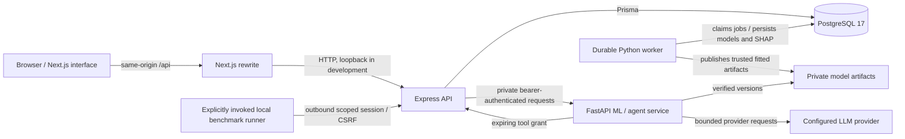

# CoreWise AI architecture — M7

The existing research documentation remains intact. This document describes the implemented application rather than the eventual product.

The repository is separated into `frontend/` (Next.js), `backend/` (Express plus `ml/`, `local-agent/`, `prisma/`) and `obsidian/` (documentation/vault). Shared contracts remain in `packages/`; root scripts and browser tests coordinate the services. Open `obsidian/` as the vault and execute pnpm commands from the repository root. Root `prisma.config.ts` resolves the schema and migration directory without duplicating or recreating migrations.

## Workspace

- `frontend`: App Router pages, CoreWise tokens, responsive shell, and overview. TanStack Query validates Express capability responses with the shared Zod schema. next-themes injects its pre-paint theme script; fonts are bundled locally using Fontsource.
- `backend`: Express foundation, Helmet, Pino request/error logging with sensitive-header redaction, rate limiting, bounded JSON parsing, JSON errors, health/readiness, capability status, and an OpenAPI discovery endpoint.
- `packages/types`: Zod contracts, provenance enum, compiled ESM and declarations shared by both applications. Rebuild this package after editing its source.
- `packages/config`: strict shared TypeScript settings.
- `prisma`: owned users/sessions, hardware, workloads/comparisons, datasets/jobs/model registry/predictions, runner jobs/measurements, SHAP, agent conversations/evidence and generated reports. Eight additive migrations preserve existing data.
- `docker-compose.yml`: loopback-bound PostgreSQL with persistent volume and readiness check. Port 55432 avoids an existing local database on 5432.

## Implemented API

| GET endpoint         | Behavior                                                                                                                   |
| -------------------- | -------------------------------------------------------------------------------------------------------------------------- |
| `/api/health`        | Process liveness; never claims a database check                                                                            |
| `/api/ready`         | Executes `SELECT 1`; returns 503 if PostgreSQL is unavailable                                                              |
| `/api/system/status` | Reports M1 public capabilities, disconnected telemetry, and an untrained model; personal inventory requires authentication |
| `/api/openapi.json`  | OpenAPI 3.1 definitions for implemented M0–M7 endpoints with request/response schemas                                      |

M1 adds the authenticated API described below. Personal endpoints use PostgreSQL sessions, HttpOnly cookies, session-bound CSRF protection, ownership scoping, and no-store responses. No frontend-to-database connection is allowed.

## Display and provenance

The initial workspace is empty and disconnected. Browser UI never probes local hardware. The opt-in demo mode uses fixed, explicitly synthetic sensor fixtures and utilization history. They are not stored, benchmarked, streamed, or used for predictions. M2 adds analytical comparisons from explicit user configurations, separate from the synthetic sensor illustrations.

Metric cards, the theme selector, shadcn-style Button (Radix Slot/CVA), and shared navigation are reusable modules. All numerical demonstration panels carry `SYNTHETIC_DEMO`. Charts use CSS tokens for both themes. Standard CSS transitions respect reduced motion; Motion is deferred until a feature needs it. M1 authentication and hardware forms use React Hook Form with shared Zod resolvers; additional primitives are added only as needed.

## Service scope

The analytical estimator and report exporter run in Express. A single private FastAPI ML/agent service handles inference/provider orchestration, with a separate durable training/SHAP worker and trusted artifact directory. The outbound benchmark runner remains an explicitly authorized separate local component. Continuous hardware monitoring is not implemented. `packages/ui` remains deferred until multiple consumers justify a separate package; current reusable UI lives in `frontend/components`.

M7 prepares production configuration and a runbook without deploying. Production requires a private API network, HTTPS, unique session/database secrets, an appropriate trusted proxy, protected persistent storage and verified backups. See DEPLOYMENT.md for the single-host reference and release gates.

## M1 authentication boundary

The API mounts a Prisma-backed `express-session` store before personal endpoints. Session cookies contain a library-generated signed identifier; user ID, CSRF token, and absolute expiry live on the server. Passwords are hashed with Argon2id. Every write requires a synchronizer token fetched through the same cookie jar. Auth attempts are rate limited and JSON bodies are bounded. Security-sensitive request/response headers are redacted from logs.

Next.js protects Hardware Library and Your Profile during server rendering by asking Express to validate the forwarded cookie. TanStack Query loads current-user and hardware data through the same-origin proxy. Registration/login clear prior client caches, and logout clears personal caches. The overview reads the selected profile, falling back to the default, but continues to show disconnected sensor values. Manual specifications never become telemetry.

| Endpoint                                    | Purpose                                          |
| ------------------------------------------- | ------------------------------------------------ |
| `GET /api/auth/csrf`                        | Session-bound CSRF token, including before login |
| `POST /api/auth/register`                   | Validated registration and new session           |
| `POST /api/auth/login`                      | Validated credentials and session regeneration   |
| `POST /api/auth/logout`                     | Session destruction and cookie removal           |
| `GET /api/auth/me`                          | Current user; 401 when unauthenticated           |
| `PATCH /api/account`                        | Update current user's display name               |
| `GET/POST /api/hardware-profiles`           | List owned inventory / create profile            |
| `GET/PUT/DELETE /api/hardware-profiles/:id` | Owned profile retrieval/update/deletion          |
| `POST /api/hardware-profiles/:id/default`   | Set one default profile                          |
| `POST /api/hardware-profiles/:id/select`    | Persist independent future-analysis selection    |

M1 responses are validated with shared Zod contracts and use data/error envelopes. The OpenAPI endpoint derives schema descriptions from the same contracts. User specifications carry `USER_ENTERED`; strict inputs reject forged ownership/provenance. Unknown optional numeric values remain null. General information, CPU, GPU, and memory specifications are captured in the library's grouped forms and detail dialogs.

Prisma indexes support session expiry, user inventory, and profile names. A composite unique key makes owned-ID operations explicit. The User's default/selected references use foreign keys with `ON DELETE SET NULL`, while profiles and sessions belong to their user with cascade deletion. No M1 feature deletes user accounts; cascade behavior exists for integrity and exact test-fixture cleanup.

See [ADR 0002](adr/0002-m1-sessions-and-ownership.md), [setup and production configuration](../README.md), and [M1 change inventory](M1-CHANGES.md). Authentication tests require PostgreSQL; they do not reset it. The browser suite retains M0 checks with explicit signed-in test fixtures and adds real UI auth/CRUD and responsive checks. Future ML/agent/local-monitor services remain deferred.

## M2 workload and analytical boundary

`Workload` stores owned editable configuration and optional hardware linkage, explicit capability assumptions, tolerance, and input provenance. `ComparisonResult` stores ESTIMATE/COMPARISON kinds with immutable workload/hardware snapshots and the complete deterministic result. Source references use ON DELETE SET NULL so edits/deletions cannot rewrite saved analytical evidence; user ownership remains on the analytical record itself.

All M2 browser calls go through Express and its M1 session/CSRF middleware. Resource IDs are scoped to the current user, including hardware overrides and comparison retrieval. The estimator is a pure backend module with no React dependency. React only formats units and renders returned values. The overview fetches real owned workloads/comparisons; no history is invented. Saved-workload links resolve through a cookie-forwarded no-store server fetch.

CPU aggregate peak is divided into a modeled single-core serial stage and multicore parallel stage. GPU offloading retains the same CPU serial stage, applies aggregate GPU throughput to the parallel fraction, and adds declared transfer and kernel costs. Per-stage roofline ceilings use max(compute time, memory time); charts add only incremental memory stall to compute. Exact units, formulas, missing-data behavior, tolerance, and limitations are documented in [M2 analytical model](M2-ANALYTICAL-MODEL.md).

The legacy public capability endpoint keeps its original M1 response contract; OpenAPI documents the new M2 endpoints separately. No existing authentication/hardware request or response schema is changed. The M2 migration adds tables/relations/indexes and does not reset data. See [M2 inventory](M2-CHANGES.md). The subsequent M3 implementation adds the private ML boundary described below.

## M3 private ML boundary

Browser → Express (database session, owner scope, CSRF, Zod) → bearer-authenticated FastAPI over a private network. A separate Python worker claims PostgreSQL TrainingJob rows with locks and renewable leases. It fits pipelines outside HTTP requests, atomically publishes UUID Joblib files, and commits all registry metadata/completion together. Failed/interrupted jobs do not activate models. Dataset versions are immutable rows; model evaluations are immutable JSON associated with each model. Prediction snapshots preserve source configuration and model versions after source edits/deletions. No browser has database, artifact, or ML service credentials. See [M3 engineering](M3-ML-ENGINEERING.md) for data schema, trust boundaries and evaluation methodology. M4 benchmarking, M5 SHAP and M6 agents remain deferred.

## M4 local execution boundary

Browser queues an explicit owned bounded benchmark via Express. A separately invoked Python local runner uses outbound HTTP(S), one-time pairing, a native-vault opaque credential and regenerated runner-only PostgreSQL sessions with CSRF. It receives only allowlisted validated config, never shell/Python source. Its spawned child measures NumPy/CuPy operations under memory/size/deadline/OS-lock controls; cancellation is polled outbound. Express independently validates raw samples/config/summaries and saves immutable MEASURED snapshots. Raw CPU-only data survives missing GPU support. Eligible paired end-to-end samples plus explicitly sourced capabilities pass the existing private M3 CSV validator before Dataset creation. This does not add a network listener, automatic benchmark worker, continuous telemetry, SHAP or an assistant. See M4 methodology for trust and timing boundaries.

## M5 explanation boundary

Express authorizes owned saved predictions/models and submits CSRF-protected requests to the bearer-authenticated private ML endpoint. Python independently checks owner scope on every source, verifies UUID artifact paths and SHA-256, and enqueues durable ModelExplanation rows. The existing dedicated worker executes SHAP in deadline-bounded child processes. Completed JSON includes source identities, reference selection, fitted transformed-feature mapping, log-time units and additivity residuals. Cache keys bind complete inputs, dataset digest, artifact/version and policy/SHAP versions. GET reads history without triggering computation. The browser renders actual backend contributions; it performs no ML fitting or attribution inference. No LangGraph/provider/conversation work is included. See M5 methodology for legacy artifact qualifications and trust limits.

## M6 agent boundary

The protected browser assistant talks only to Express, including POST SSE with cookie + CSRF. Express stores owned conversations/messages, mints hashed expiring session/CSRF-bound turn grants and invokes the existing bearer-authenticated Python service. A bounded LangGraph chooses allowlisted tools and generates provider-backed responses. Tools call only Express's fixed internal callback, which rechecks the original database session, owner scope, strict inputs and atomic call budget. Python agent code has no direct data-query/execution tool. Existing M2/M3 compute helpers are reused without persisting preview results. Benchmark/SHAP tools retrieve existing evidence and cannot initiate hardware work or SHAP jobs.

Tool calls/results, usage and server-generated references persist under assistant messages; grant transport fields clear on termination. Disconnect aborts upstream; expiry recovers interrupted state. User/history/tool content remains untrusted relative to a fixed system policy. The frontend renders returned evidence/cards and internal source links; provider text is buffered for credential filtering before SSE chunk emission. No configured provider means unavailable, never a replacement chatbot. See M6-AGENT-ARCHITECTURE.md for full protocol, budgets, retention and limitations.

## M7 reporting and workspace boundary

The protected report builder calls Express through the existing Next rewrite. Strict shared schemas bound selected IDs; a repeatable-read transaction resolves every source under the session owner and copies public source contracts into a sanitized immutable snapshot. PDFKit renders only local text/vector charts; the shared CSV helper protects spreadsheet formula cells. Neither exporter opens user URLs, files or templates. GeneratedReport stores configuration, references, snapshot, generation time, SHA-256 export metadata and exact PDF/CSV bytes. Downloads verify stored hashes and owner scope, use UUID attachment filenames and private no-store headers. Deleting sources cannot change saved reports; deleting reports cannot change sources. Account foreign-key deletion cascades. Byte storage increases database/backup size and is bounded per report/user; moving it to private object storage would require a separately reviewed change.

The authenticated workspace summary returns compact counts/latest metadata rather than unbounded dataset rows. The public overview requests it only after authentication and keys its cache by owner. Settings reuse existing account/default-profile APIs and public readiness contracts; no secrets editor or live sensor service exists. A single-host TLS proxy/private service reference is documented in DEPLOYMENT.md. No public deployment was performed.

## Neon and semantic knowledge follow-up

Local Docker retains its volume and PostgreSQL 17.7 Alpine base with a pinned pgvector extension layer. Runtime Prisma uses the selected pooled URL; the existing Prisma 6 CLI config uses the direct URL. Explicit environment guards prevent accidental remote local commands or unapproved production migrations. Python strips Prisma-only parameters, preserves TLS and disables prepared statements for pooled compatibility.

KnowledgeDocument/KnowledgeChunk add owner/private or operator-curated public source metadata and vector(384). A private cached, pinned CPU MiniLM model supplies validated embeddings; Express performs parameterized exact cosine search under database-session ownership. The twentieth LangGraph tool returns untrusted supporting documentation through existing expiring turn grants. It cannot ingest, write, execute code or replace structured timings/predictions. See [NEON-PGVECTOR.md](NEON-PGVECTOR.md) for APIs, actual backup evidence, model/version policies and the unexecuted production cutover/rollback runbook.
